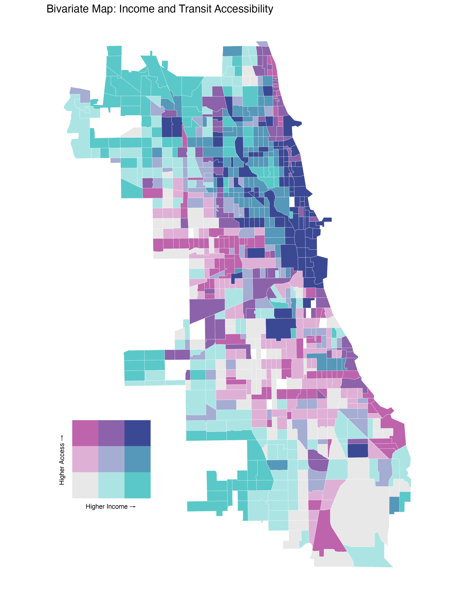

```{r setup, include=FALSE}
knitr::opts_chunk$set(echo = TRUE, warning = FALSE, message = FALSE)
```

{fig-align="center" width="85%"}

# Section I: Introduction

An equitable public transit system is the foundation of urban mobility, serving as a vital link between a city's low-income residents and essential services such as healthcare, education, and employment. Beyond just individual transportation, strong transit systems provide broad societal benefits by reducing carbon emissions and lowering street traffic. Because of Chicago's history of segregation, the distribution of CTA services serves as a critical measure of whether the city is meeting its commitment to social equity.

This project investigates whether Chicago's CTA infrastructure provides its services in an equitable manner across areas of different income levels. The central research question asks: is there a statistically significant correlation between a Chicago census tract's median household income and its level of transit accessibility? In this study, accessibility is defined not as just the physical presence of a stop but as a combination of proximity and service frequency during peak hours.

I hypothesize that there is a statistically significant positive association between income and transit accessibility. Specifically, I predict that lower-income tracts will show lower frequency-weighted accessibility scores compared to high-income tracts.

Previous studies have characterized Chicago's relationship between transit and income as a "transit divide" (Owen et al., 2023). Multiple linear regression has been used to show that "L" ridership often increases with higher median incomes in the city, while low-income residents rely primarily on bus services for daily transportation (Almagro et al., 2024; Owen et al., 2023). While past studies have traditionally focused on identifying "transit deserts" based purely on physical distance and spatial segregation (Tehrani et al., 2019) , more recent work shows that service frequency and reliability are the most important transit accessibility attributes for different income groups and transit-dependent users (Tao et al., 2022). This project builds on this literature by using a frequency-weighted spatial metric ($A_{i}$) to provide a better understanding of how service quality is distributed across Chicago.

# Section II: Data Used

In this project, I used spatial and temporal data provided by the CTA to calculate accessibility, alongside population-weighted tract centroids and demographic data from the Census Bureau to measure socioeconomic status. The datasets were selected to allow for spatial analysis of both tract-level proximity to transit and rush hour service frequency. Additionally, community area boundary data was used to subset our findings to Chicago.

| Data Category | Official Name and Link | Period and Version | Resolution / Scale | Citation |
|:--------------|:--------------|:--------------|:--------------|:--------------|
| **Stop Proximity** | [CTA Bus and 'L' Rail Stops Shapefiles](https://data.cityofchicago.org/Transportation/CTA-Bus-Stops-Shapefile/pxug-u72f) | Current (Updated Nov 2023) | Point-level (Chicago and Suburbs) | (CTA, 2023) |
| **Service Frequency** | [CTA GTFS Schedule Data](https://www.transitchicago.com/developers/gtfs/) | Spring 2024 Schedule | Route/Stop-level (minutes) | (CTA, 2024) |
| **Study Area Boundary** | [Boundaries - Community Areas](https://data.cityofchicago.org/Facilities-Geographic-Boundaries/Boundaries-Community-Areas-Map/cauq-8yn6) | Current (Downloaded April 2026) | Polygon-level (77 areas) Point-level (Tract Mean Centers) | (City of Chicago, 2026) |
| **Population Centroids** | [2020 Centers of Population](https://www.census.gov/geographies/reference-files/time-series/geo/centers-population.html) | 2020 Decennial | Point-level (Tract Mean Centers) | (U.S. Census Bureau, 2021) |
| **Income Data** | [ACS 5-Year Estimates](https://www.census.gov/programs-surveys/acs.html) | 2018-2022 | Census Tracts (Cook County) | (U.S. Census Bureau, 2023) |

# Section III: Methods

To investigate the association between transit accessibility and median household income, a spatial analysis pipeline was developed.

## Phase 1: Environment Setup and Spatial Standardization

My first phase of analysis involved standardizing the spatial scale and CRS of all datasets. To ensure accurate measurements, all spatial objects were projected from their original coordinate systems into UTM Zone 16N, which uses meters as its standard unit. In addition, tracts without median household income data were removed from the dataset to prevent errors in later statistical tests.

```{r}
library(sf)
library(dplyr)
library(readr)
library(tidycensus)
library(units)
library(ggplot2)
library(biscale)
library(cowplot)
library(spdep)
```

```{r, results = "hide", message = FALSE}
centroids_raw <- read_csv("https://www2.census.gov/geo/docs/reference/cenpop2020/tract/CenPop2020_Mean_TR17.txt")

cook_centroids <- centroids_raw %>%
  filter(COUNTYFP == "031") %>%
  mutate(GEOID = paste0(STATEFP, COUNTYFP, TRACTCE)) %>%
  st_as_sf(coords = c("LONGITUDE", "LATITUDE"), crs = 4326) %>%
  st_transform(26916) # Project to UTM Zone 16N

cook_tracts <- get_acs(
  geography = "tract",
  state = "IL",
  county = "Cook",
  variables = c(median_income = "B19013_001"),
  geometry = TRUE,
  year = 2022
) %>%
  st_transform(26916)

cook_tracts <- cook_tracts %>%
  select(GEOID, median_income = estimate, geometry)

cook_centroids <- cook_centroids %>%
  left_join(st_drop_geometry(cook_tracts), by = "GEOID")
```

## Phase 2: Processing Transit Schedule and Frequency Data

Transit accessibility was modeled as a spatial metric based on distance from a stop and the service frequency at the stop. First, CTA schedule data was filtered to isolate weekday rush hour periods. These were defined as arrivals between 7 AM to 9 AM and 5 PM to 7 PM. The total number of arrivals was then aggregated and divided by four to calculate the average number of buses per hour.

```{r}
# Load CTA Stops
stops <- read_csv('data/stops.txt') # Adjust file path as needed

stops_sf <- st_as_sf(
  stops,
  coords = c("stop_lon", "stop_lat"),
  crs = 4326
) %>%
  st_transform(26916)

stop_times <- read_csv('data/stop_times.txt') # Adjust file path as needed

peak_times <- stop_times %>%
  mutate(hour = as.integer(substr(arrival_time, 1, 2))) %>%
  filter((hour >= 7 & hour < 9) | (hour >= 17 & hour < 19))

freq_by_stop <- peak_times %>%
  group_by(stop_id) %>%
  summarise(
    total_peak_arrivals = n(),
    .groups = "drop"
  ) %>%
  mutate(buses_per_hour = total_peak_arrivals / 4)

stops_with_freq <- stops_sf %>%
  left_join(freq_by_stop, by = "stop_id") %>%
  filter(!is.na(buses_per_hour))
```

## Phase 3: Spatial Subsetting

To isolate the analysis strictly to Chicago and avoid confounding variables from suburban transit systems, the study area was subsetted to Chicago city limits. This was achieved by first dissolving Chicago's community area boundaries into a single unified polygon, then using a spatial intersection to filter Cook County tracts, population centroids, and CTA stops to those that fell within the city boundary.

```{r}
# Import community areas to establish the Chicago boundary
comm_areas <- read_csv('data/Boundaries_-_Community_Areas_20260412.csv') # Adjust file path as needed

comm_areas_sf <- st_as_sf(comm_areas, wkt = "the_geom", crs = 4326) %>%
  st_transform(26916)

# Create a single merged polygon of Chicago
chicago_boundary <- st_union(comm_areas_sf)

# Subset tracts, centroids, and stops to only those inside Chicago
tracts_chi <- cook_tracts[st_intersects(cook_tracts, chicago_boundary, sparse = FALSE), ]
centroids_chi <- cook_centroids[st_intersects(cook_centroids, chicago_boundary, sparse = FALSE), ]
stops_chi <- stops_with_freq[st_intersects(stops_with_freq, chicago_boundary, sparse = FALSE), ]
```

## Phase 4: Accessibility Matrix Calculations

Next, a distance matrix was calculated between the population-weighted centroid of each census tract and every CTA stop in Chicago. The final accessibility index was calculated as follows:

$$A_{i} = \sum_{j=1}^{n} \frac{F_{j}}{d_{ij}^2}$$

Here, $F_{j}$ represents service frequency at stop $j$ and $d_{ij}$ is that stop's distance from the population-weighted centroid of tract $i$. To prevent extreme mathematical inflation caused by squaring small distances in meters, the distance matrix was converted to kilometers. Two spatial thresholds were enforced during this calculation. Any stop further than 0.8 km from a tract's centroid was excluded from the accessibility score to reflect an approximate ten-minute walk. Additionally, a minimum distance threshold of 0.1 km was enforced in order to prevent infinite accessibility spikes when a centroid lands directly on a stop coordinate. Because transit accessibility scores are highly skewed (with a high number of stops in the Loop especially), a log-transformation was applied to the accessibility index to normalize the data for linear regression.

```{r}
#| cache: true

# 1. Calculate distance matrix (Outputs ~800 x 11,000 matrix in meters)
dist_matrix <- st_distance(centroids_chi, stops_chi)

# 2. Convert meters to kilometers instantly without 'set_units' overhead
dist_numeric <- units::drop_units(dist_matrix) / 1000

# 3. Enforce 800m (0.8km) walking threshold
dist_numeric[dist_numeric > 0.8] <- NA

# 4. Enforce 100m (0.1km) minimum distance threshold
dist_numeric[dist_numeric < 0.1] <- 0.1

# 5. Extract frequencies vector
frequencies <- stops_chi$buses_per_hour

# 6. Apply frequency-weighted gravity formula
access_scores <- apply(dist_numeric, 1, function(dists) {
  sum(frequencies / (dists^2), na.rm = TRUE)
})

# 7. Assign scores back to tracts
centroids_chi$transit_access <- access_scores

tracts_chi <- tracts_chi %>%
  left_join(st_drop_geometry(centroids_chi %>% select(GEOID, transit_access)), by = "GEOID")

# 8. Filter missing data
tracts_chi_clean <- tracts_chi %>%
  filter(!is.na(median_income), !is.na(transit_access))
```

# Section IV: Results

The hypothesis of this study was that census tracts with lower median household incomes would experience significantly lower transit accessibility. Based on the statistical analysis, this hypothesis is rejected.

## Statistical Tests

A Spearman's rank correlation was conducted to evaluate the association between median household income and log-transformed accessibility score, as it works well with non-normal data. The results indicate a very weak, positive correlation that was not statistically significant ($p = 0.65$). In addition, a simple linear regression model confirmed these findings. Median household income was not a significant predictor of transit accessibility and the model explained virtually none of the variance in the data ($R^{2} = 0.0003$).

```{r}
# Spearman Rank Correlation
cor_test <- cor.test(
  tracts_chi_clean$median_income, 
  tracts_chi_clean$transit_access, 
  method = "spearman"
)
print(cor_test)

# Simple Linear Regression
regression_model <- lm(log1p(transit_access) ~ median_income, data = tracts_chi_clean)
summary(regression_model)
```

## Visualizations and Scatterplots

The scatterplot below illustrates this lack of correlation. While accessibility scores varied drastically, this variance occurs acros all income brackets. Tracts with both the highest and lowest median incomes experience a wide range of transit service levels. The red regression line remains virtually flat across all income levels.

```{r}
ggplot(tracts_chi_clean, aes(x = median_income, y = transit_access)) +
  geom_point(alpha = 0.5, color = "darkblue") +
  geom_smooth(method = "lm", color = "red", se = TRUE) +
  scale_y_log10() + 
  scale_x_continuous(labels = scales::dollar_format()) +
  theme_minimal() +
  labs(
    title = "Correlation: Income vs. Transit Accessibility",
    x = "Median Household Income",
    y = "Transit Accessibility Score (Log Scale)"
  )
```

## Bivariate Choropleth Map

Tracts were classified into $3\times3$ quantiles based on income and accessibility to construct a bivariate choropleth map. This lack of correlation is visually apparent. Although there are pockets of transit inequity based on income—specifically in Chicago's South Side—there are many more tracts that do not fit our hypothesis, either exhibiting high transit accessibility and low median income, or low accessibility and high income.

```{r}
# Classify into 3x3 quantiles
data_bivariate <- bi_class(
  tracts_chi_clean, 
  x = median_income, 
  y = transit_access, 
  style = "quantile", 
  dim = 3
)

# Generate Map
map_bi <- ggplot() +
  geom_sf(data = data_bivariate, aes(fill = bi_class), color = "white", size = 0.1, show.legend = FALSE) +
  bi_scale_fill(pal = "DkBlue", dim = 3) + 
  theme_void() +
  labs(title = "Bivariate Map: Income and Transit Accessibility")

# Generate 3x3 Legend
legend_bi <- bi_legend(pal = "DkBlue", dim = 3, xlab = "Higher Income", ylab = "Higher Access", size = 8)

# Combine Map and Legend
ggdraw() +
  draw_plot(map_bi, 0, 0, 1, 1) +
  draw_plot(legend_bi, 0.1, 0.1, 0.25, 0.25)
```

## Spatial Autocorrelation (LISA Analysis)

While transit accessibility is not strictly tied to income, a LISA analysis reveals that it is highly dependent on spatial geography. A Local Indicators of Spatial Association (LISA) analysis was conducted using local Moran's I to allow for spatial categorization of statistically significant clusters.

The analysis identified distinct "High-high" clusters (transit hubs) located around the northern lakefront and downtown Loop area. Conversely, significant "Low-Low" clusters (transit deserts) can be found in peripheral areas of the city, specifically the far northwest and southwest sides. This suggests that transit inequity is less a result of income inequality and far more related to urban core vs. outer city spatial dynamics.

```{r}
# Create spatial weights matrix
neighbors <- poly2nb(tracts_chi_clean)
weights <- nb2listw(neighbors, style = "W", zero.policy = TRUE)

# Run Local Moran's I
lisa <- localmoran(log1p(tracts_chi_clean$transit_access), weights, zero.policy = TRUE)

# Categorize into High-High, Low-Low clusters
tracts_chi_clean <- tracts_chi_clean %>%
  mutate(
    access_scaled = as.numeric(scale(log1p(transit_access))), 
    lag_access = as.numeric(lag.listw(weights, access_scaled, zero.policy = TRUE)), 
    lisa_p = as.numeric(lisa[, "Pr(z != E(Ii))"]), 
    
    cluster = case_when(
      lisa_p > 0.05 ~ "Not Significant",
      access_scaled > 0 & lag_access > 0 ~ "High-High (Transit Hubs)",
      access_scaled < 0 & lag_access < 0 ~ "Low-Low (Transit Deserts)",
      access_scaled > 0 & lag_access < 0 ~ "High-Low (Spatial Outlier)",
      access_scaled < 0 & lag_access > 0 ~ "Low-High (Spatial Outlier)"
    )
  )

# Plot the LISA Clusters
ggplot(tracts_chi_clean) +
  geom_sf(aes(fill = cluster), color = "white", size = 0.1) +
  scale_fill_manual(values = c(
    "High-High (Transit Hubs)" = "red", 
    "Low-Low (Transit Deserts)" = "blue",
    "High-Low (Spatial Outlier)" = "pink", 
    "Low-High (Spatial Outlier)" = "lightblue",
    "Not Significant" = "grey90"
  )) +
  theme_void() +
  labs(
    title = "LISA Clusters: Transit Accessibility in Chicago",
    fill = "Cluster Type"
  )
```

# Section V: Conclusion and Limitations

## Study Limitations

While this analysis provides a broad spatial overview of CTA service frequency, several limitations should be acknowledged.

### 1. Exclusion of Regional Transit Networks

This study exclusively measured accessibility based on CTA service. Peripheral areas of Chicago may be better served by regional rail lines such as Metra and may not be as severe of transit deserts as our analysis suggests.

### 2. Proximity vs. Connectivity:

The accessibility metric factors in distance and service frequency but fails to account for destination utility. A stop servicing 20 buses an hour is scored highly even if these buses don't connect residents to meaningful services.

### 3. Centroid Generalization:

Distances were calculated using a single centroid for each census tract. In reality, a resident living on the edge of a large census tract might not be well-represented by the tract estimates used in this study.

### 4. Physical Barriers and Walkability:

The distance matrix uses Euclidean distance, assuming people can walk in a straight line and ignoring physical barriers that alter true walking distance.

## Summary

Statistical tests disproved the initial hypothesis, instead suggesting that there is no significant relationship between transit accessibility and median household income across Chicago census tracts. Instead of an income-based "transit divide," the spatial and LISA analyses demonstrated that transit accessibility in Chicago is primarily a core-periphery geographic dynamic. High-frequency transit hubs are clustered around the lakefront and downtown while transit deserts can be found on Chicago's far South and Northwest sides. To build on these findings, future studies should utilize street-network analysis instead of Euclidean distances , integrate block-level population data, and incorporate route utility and regional transit networks such as Metra and Pace to construct a comprehensive picture of transit equity in Chicago.

# References

Almagro, M., Barbieri, F., Castillo, J. C., Hickok, N., & Salz, T. (2024). Optimal urban transportation policy: Evidence from Chicago. SSRN Electronic Journal. https://doi.org/10.2139/ssrn.4735846

Chicago Transit Authority. (2023). CTA Bus and 'L' Rail Stops Shapefiles \[Data set\]. Chicago Data Portal. https://data.cityofchicago.org/

Chicago Transit Authority. (2024). CTA GTFS Schedule Data \[Data set\]. Chicago Transit Authority Developer Center. https://www.transitchicago.com/developers/gtfs/

City of Chicago. (2026). Boundaries - Community Areas (current) \[Data set\]. Chicago Data Portal. https://data.cityofchicago.org/

Owen, D., Arribas-Bel, D., & Rowe, F. (2023). Tracking the transit divide: A multilevel modelling approach of urban inequalities and train ridership disparities in Chicago. Sustainability, 15(11), 8821. https://doi.org/10.3390/su15118821

Tao, S., He, S., Ettema, D., & Luo, S. (2022). The role of transit accessibility in influencing the activity space and non-work activity participation of different income groups. Journal of Transport and Land Use, 15. https://doi.org/10.5198/jtlu.2022.2075

Tehrani, S. O., Wu, S. J., & Roberts, J. D. (2019). The color of health: Residential segregation, light rail transit developments, and gentrification in the United States. International Journal of Environmental Research and Public Health, 16(19), 3683. https://doi.org/10.3390/ijerph16193683

U.S. Census Bureau. (2021). 2020 Centers of Population by Census Tract \[Data set\]. U.S. Department of Commerce. https://www.census.gov/geographies/reference-files/time-series/geo/centers-population.html

U.S. Census Bureau. (2023). American Community Survey 5-Year Estimates, 2018-2022 \[Data set\]. U.S. Department of Commerce. https://www.census.gov/programs/acs
