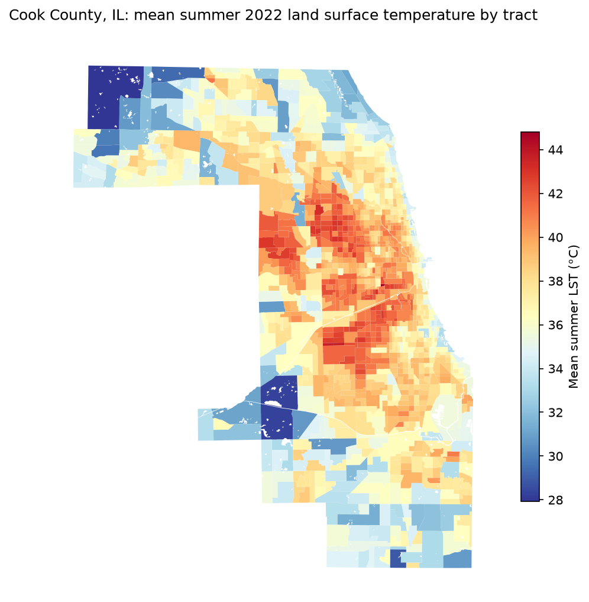

{fig-align="center" width="75%"}

## Project Overview

Extreme heat affects neighborhoods unevenly. Even within Cook County, land surface temperatures vary by more than 15 °C between tracts near forest preserves and treeless industrial corridors, and those differences often overlap with long-standing patterns of disinvestment.

This project asks three questions:

1. **Where is heat clustered?** Are hot tracts randomly scattered, or do they form statistically significant hotspots?
2. **Who is exposed?** How do hotspot neighborhoods differ in income, poverty, race/ethnicity, age and housing tenure?
3. **What drives heat locally, and does that vary across space?** Is the cooling effect of tree canopy the same everywhere?

## Interactive Dashboard

Click any tract to see its temperature, tree canopy, local regression results and how its predictors compare with the county average. The buttons above the map switch between surface temperature, local R², the tree-canopy coefficient and LISA clusters.

::: {.column-page}
<iframe src="cook-county-dashboard/index.html" title="Cook County heat vulnerability dashboard" width="100%" height="820px" loading="lazy" style="border: 1px solid #e2e2e2; border-radius: 8px;"></iframe>
:::

[Open the dashboard full screen ↗](cook-county-dashboard/index.html){target="_blank"}

## Data Sources

| Dataset | Provider | Used for |
|---|---|---|
| 2022 TIGER/Line census tracts and area water | U.S. Census Bureau | Tract geometry; water masking |
| ACS 2022 5-Year estimates | U.S. Census Bureau | Income, poverty, race/ethnicity, age 65+, renter share |
| Landsat 8/9 Collection 2 surface temperature, Jun–Aug 2022 | USGS via Microsoft Planetary Computer | Land surface temperature (LST) |
| NLCD 2021 Tree Canopy Cover | USFS / MRLC | % tree canopy |
| NLCD 2021 Impervious Surface | USGS / MRLC | % impervious surface |

All 16 cloud-filtered Landsat scenes from summer 2022 were composited per pixel (median of 6 clear observations), and tract means were taken over **land area only**, after erasing Lake Michigan and other water, so lakefront tracts aren't biased cool. One all-water tract is excluded, leaving **n = 1,331**.

## Methods

**1. Feature reduction.** The five ACS predictors had modest VIFs (1.3–2.8) but were strongly inter-correlated, so I ran a standardized PCA. PC1, a *socioeconomic deprivation* index, explains 56.3% of the variance (loading on low income, poverty, minority and renter share). PC2, an *age* index driven by the share of residents aged 65+, explains 22.5%.

**2. Spatial autocorrelation.** Using row-standardized Queen contiguity weights, I tested for clustering of LST with global Moran's *I*, then classified each tract with Local Moran's *I* (LISA) using 999 permutations and p < 0.05:

$$
I_i = \frac{z_i}{m_2} \sum_j w_{ij}\, z_j, \qquad m_2 = \frac{\sum_i z_i^2}{n}
$$

**3. Geographically weighted regression.** All variables are z-standardized:

$$
\text{LST}_i = \beta_0(u_i,v_i) + \beta_1(u_i,v_i)\,\text{Canopy}_i + \beta_2(u_i,v_i)\,\text{Deprivation}_i + \beta_3(u_i,v_i)\,\text{Impervious}_i + \varepsilon_i
$$

A global OLS model assumes one set of coefficients for the whole county. GWR fits a separate weighted regression at every tract centroid with an adaptive bisquare kernel. The bandwidth was chosen by AICc, and local significance uses the multiple-testing-corrected critical *t* of da Silva & Fotheringham (2016).

## Key Findings

### Heat is strongly clustered

Global Moran's *I* = **0.746** (z = 49.6, p = 0.001). LISA identifies **321 heat hotspot tracts** (High-High) and **273 coldspots** (Low-Low). 81% of hotspots are inside Chicago, which has only 59% of the county's tracts. They form a continuous belt across the West and Southwest Sides.

| | Hotspots (HH) | Coldspots (LL) |
|---|---:|---:|
| Mean summer LST | **41.2 °C** | **34.8 °C** |
| Tree canopy | 4.3% | 15.5% |
| Impervious surface | 75.4% | 46.5% |
| Median household income (median tract) | $66,800 | $88,400 |
| Minority (non-white) share | 72.8% | 47.0% |
| Share of tracts above median deprivation | **63%** | **30%** |

### Highest-risk neighborhoods

These are the 203 tracts that are **both** heat hotspots **and** above the county median on deprivation. They are concentrated in:

| Community area / municipality | High-risk tracts | Mean LST | Mean canopy | Mean poverty |
|---|---:|---:|---:|---:|
| South Lawndale (Little Village) | 18 | 41.3 °C | 3.1% | 22.7% |
| Austin | 17 | 41.1 °C | 4.7% | 26.8% |
| Belmont Cragin | 15 | 42.0 °C | 4.2% | 14.8% |
| Cicero | 14 | 41.2 °C | 3.5% | 14.2% |
| Near West Side | 13 | 40.4 °C | 2.1% | 30.1% |
| Brighton Park | 10 | 42.1 °C | 3.5% | 17.3% |
| Lower West Side (Pilsen) | 10 | 41.6 °C | 1.0% | 13.9% |

### GWR explains far more than a global model

| Metric | Global OLS | GWR |
|---|---:|---:|
| R² | 0.524 | **0.927** |
| AICc | 2,799.0 | **914.3** |
| Mean local R² | — | 0.735 |
| Bandwidth | — | 50 nearest neighbors |

- **Pavement is the strongest predictor** (OLS β = +0.50 SD), significant locally in 42.5% of tracts.
- **Tree canopy cools, but unevenly.** It has a significant cooling effect in 179 tracts, strongest in the Near West Side, New City, Lower West Side and Brighton Park. Several of these are also on the highest-risk list, so new canopy there would reach the hottest, most deprived residents where trees cool most effectively.
- **Deprivation works through the built environment.** On its own, deprivation is positively correlated with LST (r = +0.25), but after controlling for canopy and pavement its coefficient turns slightly negative (β = −0.07). Deprived neighborhoods are hotter *because* they have less canopy and more pavement.

## Limitations

- **Surface ≠ air temperature.** Landsat measures daytime (~10:30 a.m.) surface temperature, a proxy for urban heat island intensity rather than the air temperature people experience.
- **Canopy is underestimated** in dense urban areas by the 30 m NLCD product, so values are best used for comparison between tracts.
- **Canopy and pavement are collinear** (r = −0.87), and 50 tracts have a local condition number above 30. Multiscale GWR (MGWR) is a natural next step.
- **Ecological inference and a single summer.** Results describe tract-level associations in 2022, not individual exposure or causation.

## Tools

Python (geopandas, rasterio, rasterstats, libpysal, esda, mgwr, statsmodels, scikit-learn), DuckDB Spatial, and a Leaflet + Chart.js dashboard. The results are also exposed to LLM agents through a read-only Model Context Protocol (MCP) server.
